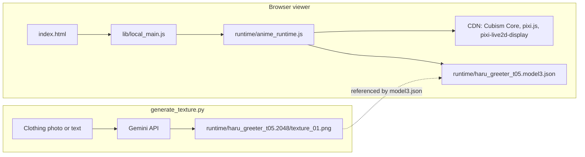

<div align="center">

# Open Avatar

**An AI-powered 2D digital human avatar with intelligent clothing replacement using Live2D and Google Gemini API.**<br/>
Renders a Live2D model in the browser and swaps its clothing texture from a photo or a text description.

[](https://github.com/juninmd/nano-live2d/actions/workflows/ci.yml)
[](https://codecov.io/gh/juninmd/nano-live2d)
[](https://www.python.org/downloads/)
[](https://opensource.org/licenses/MIT)

<br/>


</div>

> Serve the folder with `python -m http.server 8000` and open `http://localhost:8000`. To change the clothing, run `python generate_texture.py` (needs `GEMINI_API_KEY`).

## Why Open Avatar

A 2D Live2D avatar you can run locally, with its clothing changed by AI without rebuilding the model.

- **Clothing from a photo or a sentence.** Upload a clothing image or describe it; Gemini Vision reads the details.
- **Only the clothing area is regenerated.** Other parts are meant to stay unchanged.
- **Reversible.** The original texture is backed up; `restore` puts it back.

## Tour

<table>
<tr>
<td width="50%"><br/><b>Viewer</b> &ndash; the Live2D avatar rendered by <code>index.html</code>.</td>
<td width="50%">TODO(screenshot): before and after of a clothing change from <code>generate_texture.py</code>. Needs <code>GEMINI_API_KEY</code>; not captured in this run.</td>
</tr>
</table>

## Install

Prerequisites:

- Python 3.8 or higher (CI runs 3.10)
- Node.js 18 (CI version), only for the npm scripts
- A Google Gemini API key (get one from [Google AI Studio](https://makersuite.google.com/app/apikey))

```bash
git clone https://github.com/juninmd/nano-live2d.git
cd nano-live2d
pip install -r requirements.txt                    # Python runtime dependencies
export GEMINI_API_KEY='your_gemini_api_key_here'   # needed by generate_texture.py
```

> [!NOTE]
> The viewer loads Live2D Cubism Core, pixi.js, and pixi-live2d-display from CDNs at runtime, so the browser needs internet access.

## Usage

### Run the viewer

Run from the repository root:

```bash
python -m http.server 8000   # serves the folder over HTTP
```

Then open `http://localhost:8000` in your browser. Serving over HTTP is the documented path: the model is loaded with `fetch`, which `file://` pages may block (not verified in this run).

Other option, with Node.js:

```bash
npx serve
```

### Change the clothing

Run from the repository root, because the paths are relative:

```bash
python generate_texture.py
```

The tool provides three modes:

1. **Image Upload Mode**: Provide a path to a clothing image
   ```
   Input > /path/to/your/tshirt.jpg
   ```
   The AI will analyze the image and generate a 2D cartoon version.

2. **Text Description Mode**: Describe the clothing directly
   ```
   Input > red hoodie with white logo on front
   ```

3. **Restore Original**: Revert to the original texture
   ```
   Input > restore
   ```

4. **Quit**: Exit the program
   ```
   Input > quit
   ```

After generating a new texture, refresh the browser to see the change.

Example session (illustrative; requires `GEMINI_API_KEY`):

```bash
$ python generate_texture.py
==================================================
Avatar Clothing Change Tool - AI Smart Replacement
==================================================
✨ Feature: AI automatically identifies clothing position, keeps other parts unchanged

Input > red t-shirt with blue jeans
📝 Using text description: red t-shirt with blue jeans
🔄 AI is intelligently replacing clothing part...
✓ New texture saved to: runtime/haru_greeter_t05.2048/texture_01.png
✅ Clothing change complete! Texture updated
   💡 Please refresh browser to see the effect
```

## Features

- 🎨 **AI-Powered Clothing Replacement**: Upload clothing images or use text descriptions to automatically replace avatar clothing
- 🤖 **Intelligent Recognition**: Uses Gemini Vision API to understand clothing details from photos
- 🎭 **Live2D Integration**: Built on Live2D runtime for smooth 2D character animation
- 🔄 **Easy Restoration**: One-click restore to original texture
- 📸 **Multiple Input Methods**: Support both image upload and text description

## How it works



1. **Clothing Analysis** (Image Mode): When you upload a clothing image, Gemini Vision API analyzes the clothing details including:
   - Clothing type (T-shirt, hoodie, jacket, etc.)
   - Colors and color scheme
   - Patterns or logos
   - Special design elements
   - Overall style

2. **Intelligent Replacement**: The AI understands the Live2D texture layout and:
   - Identifies the torso/clothing area automatically
   - Keeps all other parts unchanged (hair, face, arms, legs, etc.)
   - Generates new clothing in 2D cartoon style matching the original
   - Maintains the exact layout and positions

3. **Texture Update**: The new texture is saved as `texture_01.png`, replacing the active texture. The original is kept in `texture_01_backup.png`.

## Technical Details

- **Model Format**: Live2D Cubism 3.0 (`.moc3`, `.model3.json`)
- **Texture Size**: 2048x2048 pixels
- **AI Models Used**:
  - `gemini-2.0-flash-exp` for image understanding
  - `gemini-2.5-flash-image` for texture generation
- **Frontend sources**: TypeScript in `src/` (ES modules, compiled with `tsc`)

## Project Structure

```
nano-live2d/
├── index.html              # Viewer page: a canvas and the loader script
├── generate_texture.py     # Interactive CLI that regenerates the clothing texture
├── requirements.txt        # Python runtime dependencies
├── pyproject.toml          # Project metadata and tool settings (black, pytest, coverage, mypy)
├── package.json            # npm scripts for the TypeScript tooling
├── tsconfig.json           # TypeScript compiler settings (rootDir src)
├── vitest.config.ts        # Vitest settings
├── src/                    # TypeScript sources (lib/ and runtime/ modules)
├── lib/
│   └── local_main.js       # Loader: injects runtime/anime_runtime.js and waits for it
├── runtime/
│   ├── anime_runtime.js    # Live2D runtime loader (loads Cubism Core, pixi.js, pixi-live2d-display)
│   ├── haru_greeter_t05.model3.json  # Model definition (moc3, textures, motions, physics)
│   ├── haru_greeter_t05.2048/        # Texture folder: texture_00.png, texture_01.png, texture_01_backup.png
│   └── motion/             # Motion files (*.motion3.json)
├── tests/                  # pytest suite for generate_texture.py
└── .github/workflows/      # ci.yml (lint, test, build, deploy) and deploy.yml (manual)
```

## Configuration

| Name | Purpose | Required or default | Example |
|---|---|---|---|
| `GEMINI_API_KEY` | Google Gemini API key read by `generate_texture.py` | Required for clothing changes; the viewer does not use it | `export GEMINI_API_KEY='your_gemini_api_key_here'` |

## Troubleshooting

### API Request Failed
- Verify your `GEMINI_API_KEY` is correctly set
- Check your network connection
- Ensure your API key has proper permissions

### Generated Texture Not Expected
- Try more detailed descriptions
- Use the `restore` command to revert
- Upload a clearer clothing image
- If the generated image has abnormal artifacts or extra parts, you can use a background removal service to clean up unwanted elements from the texture

### Import Errors
- Make sure all dependencies are installed: `pip install -r requirements.txt`
- Check Python version (3.8+ required)

### Live2D Model Not Loading
- Serve the folder over HTTP (see Usage) and check the browser console for errors
- Confirm the browser can reach the CDNs listed in the diagram above
- Ensure all runtime files are in the correct directories
- Verify file paths in `lib/local_main.js`

## Develop

```bash
pip install -r requirements.txt                              # runtime dependencies
pip install flake8 black mypy pytest pytest-cov pytest-mock  # dev tools used by CI
pytest tests/ --cov=generate_texture --cov-report=term       # tests; fails below 80% coverage (pyproject.toml)
flake8 . --count --select=E9,F63,F7,F82 --show-source --statistics  # lint, CI subset
black --check .                                              # formatting, line length 100
mypy generate_texture.py --ignore-missing-imports            # type check
npm install                                                  # TypeScript tooling
npm run typecheck                                            # tsc --noEmit over src/
npm run lint                                                 # currently fails: ESLint finds no files under src
npm test                                                     # currently fails: no tests under tests/js
```

> [!WARNING]
> `npm run build` compiles with `outDir: "."` (see `tsconfig.json`). It writes JS into the repository root and overwrites the committed `lib/local_main.js` and `runtime/anime_runtime.js`. To compile elsewhere, pass `--outDir <dir>` to `npx tsc -p tsconfig.json`.

## CI/CD Pipeline

`.github/workflows/ci.yml` runs on pushes to `main` and `develop` and on pull requests to `main`.

| Stage | What runs | Blocking |
|-------|-----------|----------|
| **Lint** | flake8 (E9, F63, F7, F82), black `--check`, mypy, ESLint on `lib/local_main.js` and `runtime/anime_runtime.js`, safety, npm audit | flake8, black, mypy, ESLint block; safety and npm audit are advisory |
| **Test** | pytest with coverage, Codecov upload | pytest fails below 80% coverage; Codecov upload does not block |
| **Build** | `python -m build`, build info and asset manifest | yes; uploads artifacts |
| **Security** | Bandit JSON report | advisory |
| **Deploy** | publishes the repository root to the `gh-pages` branch | only on pushes to `main` |

## Contributing

Open pull requests against `main`. The full process and quality gates are in [CONTRIBUTING.md](CONTRIBUTING.md).

## Security

- The Gemini key is read from `GEMINI_API_KEY` and sent as the `key` query parameter to `generativelanguage.googleapis.com` over HTTPS.
- This repository does not write the key to disk. `.env` files are listed in `.gitignore`; keep keys out of commits and logs.

## Known limitations

- The viewer needs internet access to load its runtime libraries from CDNs.
- `npm run lint` and `npm test` fail on `main` (see Develop).
- `npm run build` overwrites JS files in the repository root (see the warning in Develop).
- `.github/workflows/deploy.yml` is a placeholder: it prints messages and does not deploy anything.
- Texture output comes from an external model and varies between runs; use `restore` to go back.

## License

MIT, as declared in `pyproject.toml`. The repository does not include a LICENSE file.
